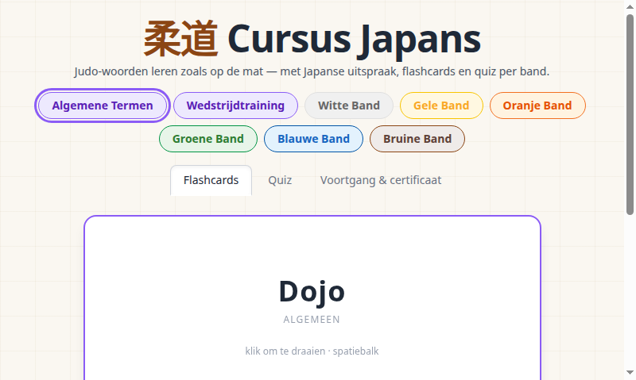
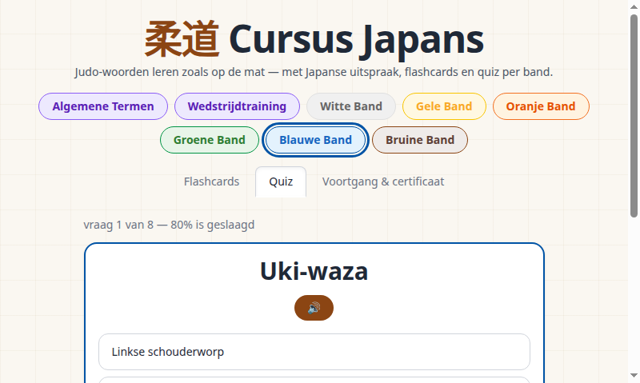

# Cursus Japans — judo-woorden leren met echte Japanse uitspraak

*English summary at the bottom.*

**Live demo:** https://robertdingenouts.github.io/cursus-japans/ — alles draait in je browser, geen account, geen tracking.

Leermodule die ik bouwde voor mijn judoclub: 157 Japanse judotermen, van witte tot bruine band, met flashcards, quiz per band en een printbaar certificaat. Het bijzondere: **elk woord klinkt in het Japans** — 157 audiotjes die ik vooraf lokaal genereerde met een eigen tekst-naar-spraakpijplijn (Edge TTS), dus geen cloud en geen kosten per afspeelbeurt.




**Demo (12 seconden):** [assets/demo.mp4](assets/demo.mp4)

## Wat het doet

- **Flashcards**:klik of spatiebalk om te draaien, ←/→ om te bladeren, 🔊 voor de Japanse uitspraak
- **Quiz per band**: 8 vragen, 80% is geslaagd — voorbeeld van een werkproces dat ik 1-op-1 uit mijn productiesysteem heb gehaald
- **Voortgang & certificaat**: alles blijft lokaal in de browser (localStorage), certificaat met eigen naam te printen
- **Brondata als leesbaar TypeScript**: [data/terms.ts](data/terms.ts) — alle 157 termen, per niveau en categorie

## Tech

Next.js 16 · React 19 · TypeScript · Tailwind 4 · statische export (draait overal: GitHub Pages, Vercel, USB-stick) · geen database, geen backend

Audio-bestanden: `/public/audio/japanese/<woord>.wav`, gelabeld op de romaji-uitspraak — dezelfde mapping als in mijn clubplatform, dus de module is ook daar 1-op-1 terug te vinden (en omgekeerd).

## Hoe ik het bouwde

Ontworpen en gebouwd door mij met AI-agents onder mijn aansturing: de datamodule en de audio-pijplijn zijn eerder gemaakt voor [judoclub-platform](https://github.com/RobertDingenouts/judoclub-platform) (mijn complete clubsysteem, draait live op [judoclubmichigami.nl](https://judoclubmichigami.nl)); deze losse versie is bewust database-vrij gemaakt, zodat de lesstof ook zonder inlogwerk overal inzetbaar is — bijvoorbeeld voor andere judoclubs.

## Zelf draaien

```bash
npm install
npm run dev        # of: npm run build && npx serve out
```

## Broncode en licentie

Alle rechten voorbehouden. De lesmethode en audio zijn van mij; hergebruik door andere clubs tegen licentie — neem contact op.

---

## English summary

Interactive Japanese-for-judo vocabulary course: 157 belt-graded terms with flashcards, per-belt quizzes, a printable certificate and **locally generated Japanese audio for every word** (Edge TTS pipeline, no cloud). Built with Next.js 16, React 19 and Tailwind 4 as a fully static app — no database, no backend, progress lives in the browser. Designed and built by me with AI agents under my supervision; the data and audio modules come from my production club platform and are re-used here in a standalone, login-free form. Live demo above; all code and measurement pipelines are genuinely mine.
